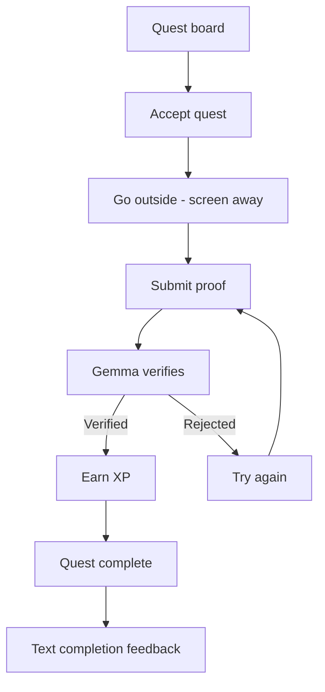

# SideQuest T&T

SideQuest T&T is an AI-powered real-world RPG that uses a local open-weight
Gemma model to generate a shared daily quest pool for Trinidad, getting players
off their screens and out exploring.

## Product principle

This is a game whose quests happen in the real world—not a travel planner. The
screen should disappear for the largest part of the experience, supporting the
Hacktoberfest Week 1 "Touch Grass" theme.

## Core game loop



## Proposed architecture

```mermaid
flowchart TD
    U[User] --> UI[React + Vite UI on Vercel]
    UI -->|HTTPS /api| API[NestJS API on Render / Local]
    API --> DB[MongoDB Atlas - player and game state]
    HS[Home server / Worker daemon] -->|Fetch templates & publish pool| API
    HS -->|Poll for verification jobs| API
    HS -->|Post signed verification result| API
    HS --> AI{USE_NVIDIA?}
    AI -->|true (default)| NV[NVIDIA NIM Cloud API\nGoogle Gemma 2 27B & Llama 3.2 Vision]
    AI -->|false| LOC[Local Ollama / Gemma Runtime]
```

Gemma generates a shared daily quest pool for Trinidad and Tobago from curated
regional templates enriched with live seasonal events. The home server or
background worker communicates with the NestJS API over HTTPS to fetch templates,
run AI generation, and poll for quest verification submissions; it never connects
directly to MongoDB Atlas. 

### Model Provider Configuration (`USE_NVIDIA`)

SideQuest T&T supports both cloud-accelerated inference via NVIDIA NIM and local
open-weight model execution via Ollama. This is controlled by the `USE_NVIDIA`
environment flag in `backend/worker/.env`:

- **NVIDIA NIM (Default, `USE_NVIDIA=true`)**: Uses NVIDIA NIM cloud endpoints
  with Google Gemma 2 27B (`google/gemma-2-27b-it`) for rich quest generation and
  multimodal vision models (`meta/llama-3.2-11b-vision-instruct`) for photo proof
  verification. Requires `NVIDIA_API_KEY`.
- **Local Ollama (`USE_NVIDIA=false`)**: Falls back to your local Ollama runtime
  (e.g., `gemma4:e2b-it-qat` or local Gemma instance) running on the host machine.

### Regional Support & Live Seasonality

- **Trinidad & Tobago Regions**: Players can select their island (Trinidad or
  Tobago). Each island maintains its own distinct daily quest pool, templates,
  and seasonal context (such as Tobago Carnival, Heritage Festival, or local cultural
  milestones).
- **Photo & Roll Evidence Verification**: Quest submissions accept live camera
  photos as well as camera roll uploads, with automated photo EXIF timestamp
  validation against quest acceptance dates to prevent stale photo re-use.

## Project status

The NestJS API supports guest sessions, island-specific quest boards (Trinidad
and Tobago), dynamic pool refreshing, text and photo evidence submission, EXIF
date verification, worker verification, and server-authoritative XP. The
background worker runs continuously or as a scheduled systemd service to generate
daily pools and verify quest submissions. A responsive React/Vite player flow is
hosted on Vercel with same-origin `/api` proxying.

## Run locally

Start the API using the existing Atlas connection:

```sh
cd backend
npm install
npm run start:dev
```

In another terminal, start the player app:

```sh
cd frontend
npm install
npm run dev
```

The frontend defaults to `http://localhost:3000/api`. Copy
`frontend/.env.example` to `frontend/.env` to set `VITE_API_BASE_URL` to a
different local API origin and `/api` prefix. Production builds use the
same-origin `/api` proxy configured in `frontend/vercel.json`. For local
browser requests, set the ignored `backend/.env` value
`FRONTEND_ORIGIN=http://localhost:5173`. Frontend configuration contains no
worker, database, or model credentials.

The player flow uses a browser guest cookie, displays the current or dated
fallback quest pool, shows quest criteria and safety guidance before
acceptance, submits text reflections, and polls server verification status.
Evidence remains in page memory only and is not stored in browser storage.
Verified XP is displayed only from the API response.

The player has completed real outdoor quests and confirmed the retry flow on
mobile. The current production pool is still the original seeded pool. The
board now requests a generated pool on first visit for a Trinidad date without
one, while keeping the previous pool available; the home-server worker must be
running to fulfill that request. Existing acceptances, submissions, and
completions remain intact. The API and verification worker use matching
credentials and a 120-second lease.
