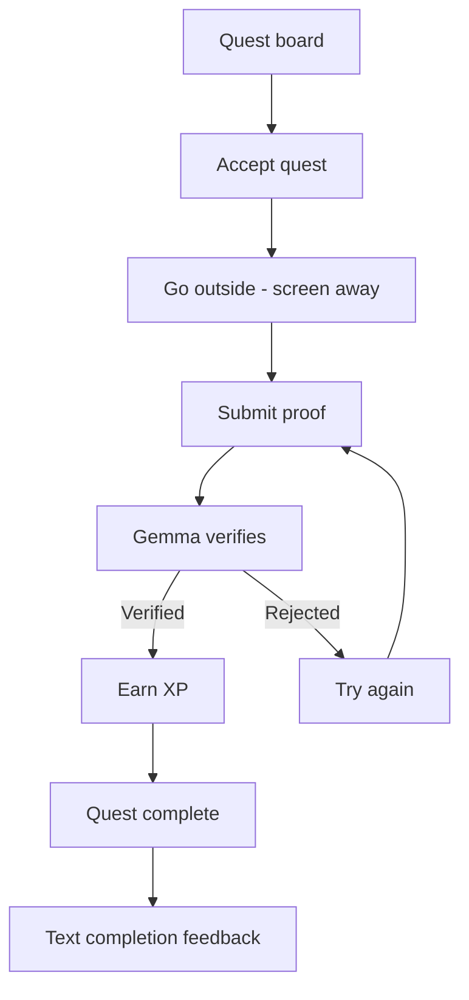
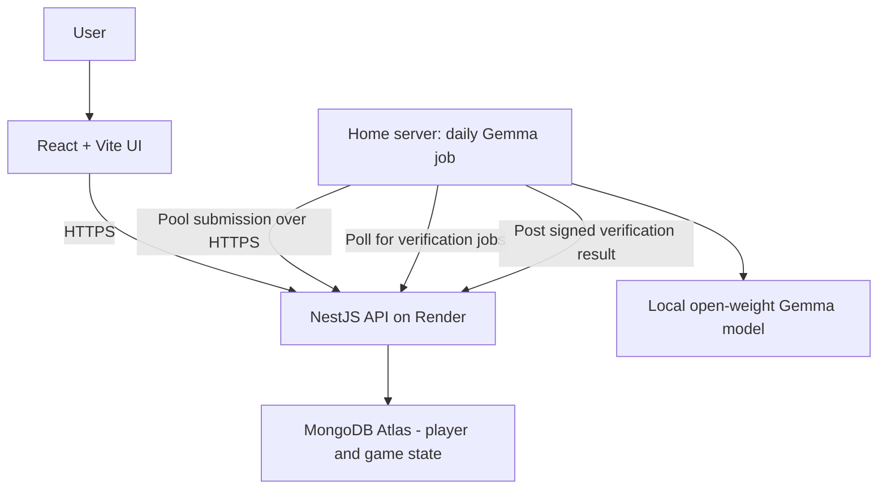

# SideQuest T&T

SideQuest T&T is an AI-powered real-world RPG that uses a local open-weight
Gemma model to generate a shared daily quest pool for Trinidad, getting players
off their screens and out exploring.

## Product principle

This is a game whose quests happen in the real world—not a travel planner. The
screen should disappear for the largest part of the experience, supporting the
Hacktoberfest Week 1 "Touch Grass" theme.

## Core game loop

## Proposed architecture

Gemma generates one shared pool of 5–10 quests daily from reviewed templates.
The home server sends the pool to Render and polls for verification jobs; it
never connects directly to Atlas. Players cannot reroll. If today's generation
fails, the app shows the most recently published pool with its date. If no
pool has been published yet, the board shows an unavailable state. A quest
completed yesterday is marked but can be tried again; XP is awarded only once
for each player and quest instance. The MVP uses guest accounts and awards 25,
50, or 100 XP by rarity. Voice, levels, and Tobago selection are deferred.
MongoDB Atlas persists game state through the API.

## Project status

The repository is initialized and the product direction and proposed
architecture are documented. Implementation and deployment are not yet in
place.
