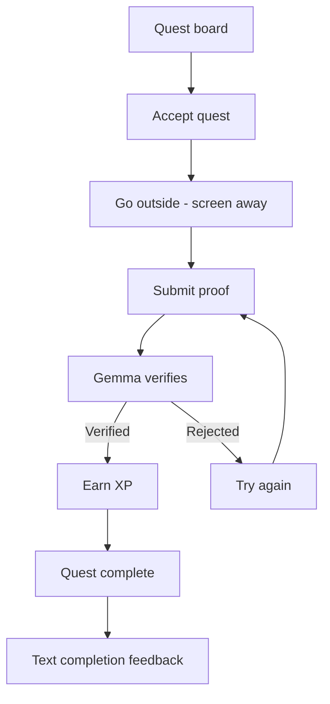
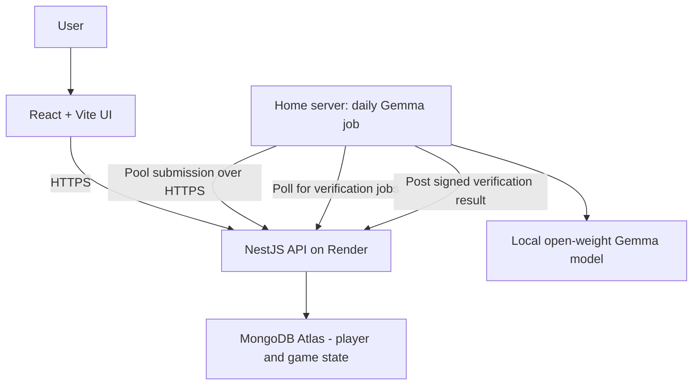

# SideQuest T&T

SideQuest T&T is an AI-powered real-world RPG that uses a local open-weight
Gemma model to generate a shared daily quest pool for Trinidad, getting players
off their screens and out exploring.

## Product principle

This is a game whose quests happen in the real world—not a travel planner. The
screen should disappear for the largest part of the experience, supporting the
Hacktoberfest Week 1 "Touch Grass" theme.

## Core game loop



## Proposed architecture



Gemma generates one shared pool of 5–10 quests daily from reviewed templates.
The home server sends the pool to Render and polls for verification jobs; it
never connects directly to Atlas. Players cannot reroll. If today's generation
fails, the app shows the most recently published pool with its date. If no
pool has been published yet, the board shows an unavailable state. A quest
completed today or yesterday is marked but can be tried again; XP is awarded
only once for each player and quest instance. The player header shows the
server-reported total XP, updated when verification completes. The MVP uses
guest accounts and awards 25, 50, or 100 XP by rarity. Voice, levels, and
Tobago selection are deferred.
MongoDB Atlas persists game state through the API.

## Project status

The NestJS API now supports guest sessions, the Trinidad quest board,
acceptance, text evidence, worker verification, and server-authoritative XP.
The home-server worker has completed a real local inference using Ollama model
`gemma4:e2b-it-qat`. A small React/Vite player flow is available in `frontend/`
and hosted on Vercel; the API is hosted on Render. Vercel proxies `/api/*` to
the Render API so the browser uses a same-origin guest cookie, including on
mobile browsers with strict third-party cookie handling.

## Run locally

Start the API using the existing Atlas connection:

```sh
cd backend
npm install
npm run start:dev
```

In another terminal, start the player app:

```sh
cd frontend
npm install
npm run dev
```

The frontend defaults to `http://localhost:3000/api`. Copy
`frontend/.env.example` to `frontend/.env` to set `VITE_API_BASE_URL` to a
different local API origin and `/api` prefix. Production builds use the
same-origin `/api` proxy configured in `frontend/vercel.json`. For local
browser requests, set the ignored `backend/.env` value
`FRONTEND_ORIGIN=http://localhost:5173`. Frontend configuration contains no
worker, database, or model credentials.

The player flow uses a browser guest cookie, displays the current or dated
fallback quest pool, shows quest criteria and safety guidance before
acceptance, submits text reflections, and polls server verification status.
Evidence remains in page memory only and is not stored in browser storage.
Verified XP is displayed only from the API response.

The local browser flow has been verified through a pending submission. Active
quests and their latest submission status are restored after a page refresh.
The frontend's verified, retry, and review states have not yet been exercised
in-browser. Hosted
verification and outdoor playtesting remain unverified. For hosted worker
verification, set `VERIFICATION_WORKER_SECRET` on both Render and the
home-server worker to the same value and set `VERIFICATION_LEASE_SECONDS=120`
on both; configure the worker's `API_BASE_URL` with the actual deployed API
origin rather than a placeholder.
