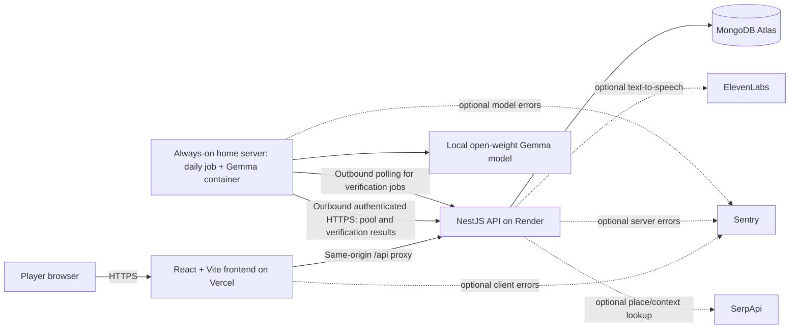
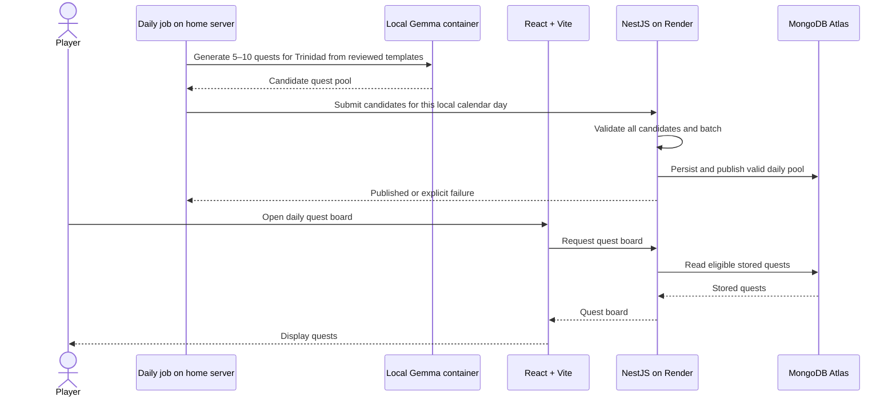

# SideQuest T&T — Proposed Architecture

**Status:** Proposed MVP architecture; implementation choices may change as the first vertical slice is built.

## System overview

The repository README establishes a React + Vite frontend, a NestJS API hosted on Render, MongoDB Atlas for game state, and a local open-weight Gemma model for product AI. Gemma runs in a container on the always-on home server and generates a shared daily quest pool for Trinidad. ElevenLabs supplies optional Quest Master voice. Sentry and SerpApi are optional integration points, not MVP dependencies.



## Component responsibilities

### React + Vite frontend

- Presents the Trinidad daily quest board, quest details, acceptance, evidence submission, verification result, and server-returned XP. Manual Tobago selection is a stretch goal.
- Displays the pool's actual date when serving a previous pool. Shows a dated completion marker such as `Completed yesterday` without disabling re-acceptance.
- Returns each player's most recent completion date for each quest instance as board metadata; the marker does not alter quest availability.
- Calls the API with credentialed requests to preserve the HttpOnly guest cookie and treats backend state as authoritative. Local development uses `VITE_API_BASE_URL`; production calls same-origin `/api`.
- Keeps submitted evidence in component memory only; it is not persisted in browser storage or logged.
- Keeps the player experience usable when voice playback is missing or blocked.
- Does not contain database credentials, model credentials, or ElevenLabs secrets.
- For local development, the API must set `FRONTEND_ORIGIN` to the exact Vite origin (`http://localhost:5173` by default); credentialed CORS never uses a wildcard.
- On startup, requests `GET /api/quests/active` after reusing or creating the guest session. The API returns the active acceptance snapshot and latest submission status without evidence, or the latest completed result when no quest is active, so completion feedback survives refresh.
- Vercel rewrites `/api/*` to the Render API while keeping the browser URL on the frontend origin. This makes the guest cookie first-party for mobile browsers that restrict third-party cookies. Keep the external API rewrite before the SPA fallback rewrite in `frontend/vercel.json`.

### NestJS API on Render

- Owns request validation, quest and completion lifecycle, persistence, guest identity, and XP awards.
- Creates a guest profile without email/password and issues a server-managed secure, HttpOnly cookie; guest progress is not recoverable across browsers/devices in the MVP.
- Reads and writes MongoDB Atlas through server-side credentials; only the API has database write access.
- Accepts authenticated daily quest candidates from the home-server generator, validates them, and persists the pool. Queues evidence for local Gemma assessment and validates the worker's structured result before acting on it.
- Ensures completion transitions and XP awards are idempotent.
- Authenticates guest sessions and home-server requests, and rate limits expensive AI operations. Image upload limits apply only if evidence media is added after the MVP.
- Uses text for MVP feedback; ElevenLabs is deferred.

### MongoDB Atlas

Use separate, explicitly modeled records rather than one mutable player document:

- **Player:** minimal guest identity and progression summary.
- **Region:** Trinidad for the MVP; manual Tobago selection is a stretch goal. Quests may use bounded local context without imposing a single pilot district.
- **Quest template:** human-reviewed activity shape, safety limits, and completion criteria used to bound Gemma's generation.
- **Quest pool batch:** one generation/publication record per region and local calendar day, used to make the daily job idempotent.
- **Quest instance:** an immutable, validated, versioned quest shown to players, with rarity, region, reward, criteria, safety guidance, and generation metadata.
- **Accepted quest:** one player's acceptance of one quest instance, with a state and timestamps.
- **Submission attempt:** numbered text evidence and its verification status/result, associated with an accepted quest. A model outage can leave an attempt pending for re-verification without requiring new evidence.
- **Completion:** one unique completion per accepted quest.
- **XP ledger entry:** one immutable award associated with that completion; `users.xp` is a summary updated atomically with the award.

The API owns transitions and enforces a unique completion per acceptance and one XP award per player per quest instance. Repeated requests must be idempotent. Credentials remain in server-side secrets, and database access is restricted to the application service.

### Local Gemma service and model

For home-server communication, the worker fetches reviewed templates, submits
the generated pool, claims pending verification jobs from Render, then posts
structured model results to the API for validation. These internal endpoints
use a dedicated `VERIFICATION_WORKER_SECRET` bearer credential. Pool
publication is date-scoped and transactional; verification claims are atomic
and time-limited. Do not expose an inbound model port or give either worker
MongoDB credentials.

Gemma is the product AI, responsible for:

- Generating one shared daily pool of 5–10 quest instances for Trinidad from human-reviewed templates and bounded local context. Do not generate an unbounded catalog or allow player-triggered rerolls for the MVP.
- Assessing submitted evidence against explicit quest criteria.
- Optionally adapting quest wording or difficulty within product-defined bounds.

Gemma does not write directly to MongoDB or award XP. It returns candidate content or an assessment; the NestJS API validates the result, persists state, and makes game-rule decisions.

#### Structured output and validation

Define versioned JSON contracts for quest generation and evidence assessment. Validate both syntactic shape and product rules at the API boundary. Checks should include required fields, enum values, string lengths, valid duration and XP ranges, the configured region, nonempty completion criteria, and safety constraints. Reject or safely retry invalid responses. Escape or render model text as untrusted content, and never interpret model output as executable instructions or database queries.

Example assessment contract (illustrative):

```json
{
  "status": "verified",
  "reason": "The response addresses the quest's completion criteria.",
  "confidence": 0.87,
  "failedCriteria": []
}
```

Allowed status values are `verified`, `retry`, and `review`. The API requires a
short reason (up to 500 characters), confidence in `[0, 1]`, and failed
criteria drawn from the accepted snapshot. The initial confidence threshold is
`0.75`; a lower score cannot pass. The API converts explicit `review` and
below-threshold results to a retryable outcome because the MVP has no staffed
manual review. Invalid output, timeout, and model failure award no XP; invalid
results remain pending and worker failures can release the claim or allow its
lease to expire. A retryable result returns the acceptance to player-retryable
state while retaining its active marker. No valid structured `verified`
result meeting the confidence threshold means no XP award.

#### Local-to-hosted connectivity decision

A local model is not automatically reachable from an API deployed on Render.
Gemma is intended to run in a container on the always-on home server. A daily
generation job runs there and sends candidates to an authenticated NestJS API
endpoint over HTTPS; the API validates and persists the pool in Atlas. The
model container and worker have no Atlas credentials or direct database access.
For verification, the API exposes authenticated claim, assessment-result, and
worker-failure endpoints. Claiming atomically leases a pending attempt; lease
expiry makes an unreported failure retryable. The claim contains the accepted
quest snapshot, criteria, and evidence. The worker sends only those three
inputs to Gemma, then returns the structured assessment with its claim token.
The API validates the response and owns every state transition and XP award.
Render never opens a connection to the home network. If the home server or
model is unavailable, attempts remain pending/retryable and earn no XP.

The repository contains the NestJS worker API and Node.js home-server workers
in `backend/worker/`. The verification worker polls the claim endpoint, calls a
configurable Ollama-compatible `/api/chat` endpoint, validates the structured
assessment, and submits a result or bounded failure code. The pool generator
fetches active templates and calls the same local runtime to generate bounded
titles, descriptions, and durations. Configure
`VERIFICATION_WORKER_SECRET` in the API and worker, and use the same
`VERIFICATION_LEASE_SECONDS` value on both. The home-server deployment must
supply its HTTPS API origin, local runtime base URL, and exact installed model
name through environment variables. No model version or credential is
embedded in the repository.

The verification worker sends only the accepted quest snapshot, completion
criteria, and evidence to the local runtime. It never sends attempt IDs, claim
tokens, or API credentials to the model; it has no MongoDB access and exposes
no inbound port. The generator sends only reviewed template guidance and
criteria to Gemma; the API retains authoritative proof requirements, safety
guidance, difficulty, rarity, and XP. API and model requests have bounded
timeouts. Failed or malformed results do not replace a published pool. A
disposable local end-to-end run with
Ollama's installed `gemma4:e2b-it-qat` completed in 13.484 seconds. The model
returned a valid `review` assessment, which the local API stored without
awarding XP because the sample evidence did not establish the quest criteria.
This verifies one local inference/result path, not a hosted deployment or
general model reliability.

When a player opens the quest board and today's pool is missing, the API stores
one generation request for the Trinidad date. The home-server worker polls for
requests every 30 seconds and generates only requested pools. The board keeps
serving the latest published pool, labeled with its date, while generation is
pending; the frontend refreshes until today's pool is published. If no pool
has ever been published, show an unavailable state while generation proceeds.
A published pool for the same date is never replaced. The worker must remain
running on the home server; page requests cannot reach Ollama directly.

### ElevenLabs

ElevenLabs is a possible later enhancement for Quest Master narration. Voice is deferred from the MVP; use clear text for quest introductions and completion feedback first. If voice is added later, it does not decide quest rules or verify evidence. Keep the API key on the server and provide text as a fallback.

### Optional integrations

- **Sentry:** Optional error reporting for frontend, API, and model-service failures. Scrub tokens, submitted evidence, and other personal data from events; configure sampling and retention deliberately.
- **SerpApi:** Optional source of place or local-context information if later quest quality requires current external data. It is not required for MVP. Treat results as untrusted, validate them, and avoid generating quests that depend on unverified hours, access, safety, or availability. Keep its key server-side.

## Data flows

### Quest generation and retrieval



### Completion verification

```mermaid
sequenceDiagram
    actor Player
    participant UI as React + Vite
    participant API as NestJS on Render
    participant Worker as Home-server worker
    participant Model as Local Gemma model
    participant DB as MongoDB Atlas

    Player->>UI: Submit written evidence
    UI->>API: Completion attempt
    API->>DB: Load accepted quest and criteria
    API->>DB: Store pending verification job
    API-->>UI: Pending result
    Worker->>API: Claim pending attempt (HTTPS bearer auth)
    API-->>Worker: Lease token, snapshot, criteria, and private evidence
    Worker->>Model: Assess snapshot + criteria + evidence only
    Model-->>Worker: Structured assessment
    Worker->>API: Return assessment + lease token
    API->>API: Validate response and apply thresholds
    alt Verified
        API->>DB: Transaction: complete attempt and acceptance, clear active quest, award XP once
        API-->>Worker: Verified result and awarded XP
        UI->>API: Poll attempt status
        API-->>UI: Verified result
    else Retry, review, or inference unavailable
        API->>DB: Store retry/review result or release failed claim without XP
        API-->>Worker: Result or retryable failure
        UI->>API: Poll attempt status
        API-->>UI: Status and reason; never evidence
    end
```

Daily generation is initiated on the home server and pushed to the hosted API;
the API remains the only Atlas writer. The home-server worker claims jobs and
posts results over outbound authenticated HTTPS. Render never opens a
connection to the home network. Keep the worker secret and per-claim token out
of model prompts and logs; never expose a model port.

## Daily pool and repeat completion behavior

If today's batch fails validation or generation, serve the most recently published batch with its actual date and a clear previous-pool label; do not publish partial content. Keep that pool available until a newer pool is successfully published. On each player's board, mark any matching quest they completed yesterday as `Completed yesterday`; show the completion date for older completions. Keep the re-accept action available. XP is granted only for the player's first verified completion of that quest instance.

The MVP awards 25 XP for Common, 50 for Uncommon, and 100 for Rare. It shows
total XP and completion history; levels are deferred. XP awards are unique per
guest and quest instance and are written with completion state and the user XP
total in one Atlas transaction. Submitted text is deleted 30 days after
submission, while verification metadata is retained. A submission still
pending at day 30 expires without XP.

## MVP screen-away behavior

The active-quest view should show only the essential task, safety guidance, and a clear way to return and submit text evidence. “Offline” means screen-away time, not offline app support: acceptance and evidence submission require connectivity, and the UI must clearly report when the service is unreachable. No live map, GPS, or continuous location tracking is part of the MVP. Quest instructions must make safety guidance visible before the player accepts.

## Development AI and product AI

GitHub Copilot is the development assistant: it may help write, explain, test, refactor, debug, and document the application. Gemma is the product runtime model: it generates and assesses quests for players. Copilot does not power player-facing quest behavior, and Gemma does not replace normal code review or application validation. The development log should record meaningful Copilot-assisted steps and human review so the experiment is reproducible.

## Security and privacy

- Use HTTPS for browser/API traffic and authenticated service-to-service calls.
- Store secrets in local environment files excluded from version control and in Render's secret configuration; never commit Atlas, ElevenLabs, SerpApi, or model-service credentials.
- Restrict MongoDB Atlas network access and database permissions to the required application environment.
- Validate every API input and every model output. Apply request size limits, rate limits, and safe error responses.
- Treat user text, uploaded media, search results, and model responses as untrusted data.
- Collect the minimum player information needed. Do not collect continuous location data for the MVP.
- The MVP stores text evidence only. If evidence media is added later, define access control, retention, deletion, accepted formats, and upload limits. Avoid logging raw evidence or secrets to Sentry or application logs.
- Enforce server-side quest state transitions and idempotent XP awards; do not trust client-supplied completion status or reward values.
- A model's evidence assessment is fallible. Communicate retries clearly and never claim that it proves physical presence or identity.
