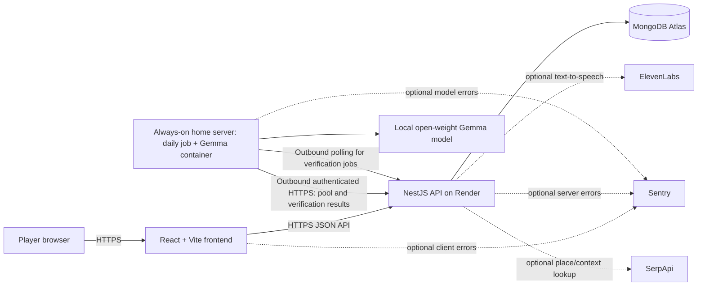
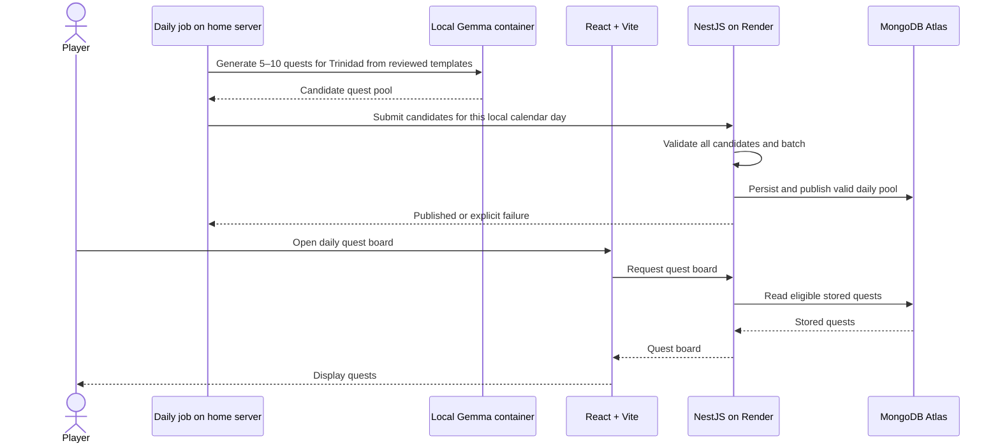
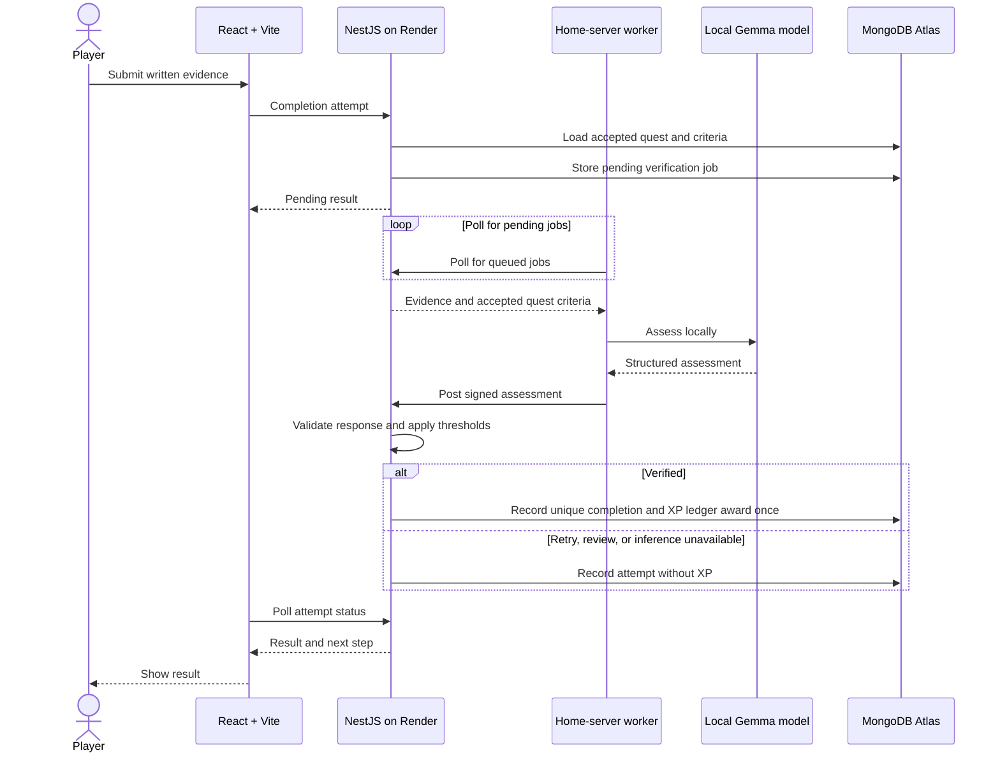

# SideQuest T&T — Proposed Architecture

**Status:** Proposed MVP architecture; implementation choices may change as the first vertical slice is built.

## System overview

The repository README establishes a React + Vite frontend, a NestJS API hosted on Render, MongoDB Atlas for game state, and a local open-weight Gemma model for product AI. Gemma runs in a container on the always-on home server and generates a shared daily quest pool for Trinidad. ElevenLabs supplies optional Quest Master voice. Sentry and SerpApi are optional integration points, not MVP dependencies.



## Component responsibilities

### React + Vite frontend

- Presents the Trinidad daily quest board, quest details, acceptance, evidence submission, completion result, history, and total XP. Manual Tobago selection is a stretch goal.
- Displays the pool's actual date when serving a previous pool. Shows a dated completion marker such as `Completed yesterday` without disabling re-acceptance.
- Returns each player's most recent completion date for each quest instance as board metadata; the marker does not alter quest availability.
- Calls the API over HTTPS and treats backend state as authoritative.
- Keeps the player experience usable when voice playback is missing or blocked.
- Does not contain database credentials, model credentials, or ElevenLabs secrets.

### NestJS API on Render

- Owns request validation, quest and completion lifecycle, persistence, guest identity, and XP awards.
- Creates a guest profile without email/password and issues a server-managed secure, HttpOnly cookie; guest progress is not recoverable across browsers/devices in the MVP.
- Reads and writes MongoDB Atlas through server-side credentials; only the API has database write access.
- Accepts authenticated daily quest candidates from the home-server generator, validates them, and persists the pool. Queues evidence for local Gemma assessment and validates the worker's structured result before acting on it.
- Ensures completion transitions and XP awards are idempotent.
- Authenticates guest sessions and home-server requests, and rate limits expensive AI operations. Image upload limits apply only if evidence media is added after the MVP.
- Uses text for MVP feedback; ElevenLabs is deferred.

### MongoDB Atlas

Use separate, explicitly modeled records rather than one mutable player document:

- **Player:** minimal guest identity and progression summary.
- **Region:** Trinidad for the MVP; manual Tobago selection is a stretch goal. Quests may use bounded local context without imposing a single pilot district.
- **Quest template:** human-reviewed activity shape, safety limits, and completion criteria used to bound Gemma's generation.
- **Quest pool batch:** one generation/publication record per region and local calendar day, used to make the daily job idempotent.
- **Quest instance:** an immutable, validated, versioned quest shown to players, with rarity, region, reward, criteria, safety guidance, and generation metadata.
- **Accepted quest:** one player's acceptance of one quest instance, with a state and timestamps.
- **Submission attempt:** numbered text evidence and its verification status/result, associated with an accepted quest. A model outage can leave an attempt pending for re-verification without requiring new evidence.
- **Completion:** one unique completion per accepted quest.
- **XP ledger entry:** one immutable award associated with that completion; `users.xp` is a summary updated atomically with the award.

The API owns transitions and enforces a unique completion per acceptance and one XP award per player per quest instance. Repeated requests must be idempotent. Credentials remain in server-side secrets, and database access is restricted to the application service.

### Local Gemma service and model

For home-server communication, the worker submits the generated pool, polls Render for pending verification jobs, then posts structured model results to the API for validation. Use HTTPS with a dedicated service credential and request signing/replay protection. Do not expose an inbound model port.

Gemma is the product AI, responsible for:

- Generating one shared daily pool of 5–10 quest instances for Trinidad from human-reviewed templates and bounded local context. Do not generate an unbounded catalog or allow player-triggered rerolls for the MVP.
- Assessing submitted evidence against explicit quest criteria.
- Optionally adapting quest wording or difficulty within product-defined bounds.

Gemma does not write directly to MongoDB or award XP. It returns candidate content or an assessment; the NestJS API validates the result, persists state, and makes game-rule decisions.

#### Structured output and validation

Define versioned JSON contracts for quest generation and evidence assessment. Validate both syntactic shape and product rules at the API boundary. Checks should include required fields, enum values, string lengths, valid duration and XP ranges, the configured region, nonempty completion criteria, and safety constraints. Reject or safely retry invalid responses. Escape or render model text as untrusted content, and never interpret model output as executable instructions or database queries.

Example assessment contract (illustrative):

```json
{
  "status": "verified",
  "reason": "The response addresses the quest's completion criteria.",
  "confidence": 0.87,
  "failedCriteria": []
}
```

Allowed status values are `verified`, `retry`, and `review`. The contract must also define the reason length, confidence range, and failed-criteria shape. Confidence thresholds and retry behavior belong in application code, not in the model. No valid structured `verified` result means no XP award. On timeout, outage, malformed output, or low confidence, retain the attempt as pending/retryable and let the home-server worker retry verification after the service recovers; do not convert an error into an automatic pass. Manual review is deferred for the MVP.

#### Local-to-hosted connectivity decision

A local model is not automatically reachable from an API deployed on Render. Gemma runs in a container on the always-on home server. A daily generation job runs there and sends candidates to an authenticated NestJS API endpoint over HTTPS; the API validates and persists the pool in Atlas. The model container has no Atlas credentials and no direct database access. For verification, the API records pending work; the home-server worker polls an authenticated endpoint, evaluates each submission locally, then posts the structured result to the API. Do not expose an inbound model port. If the home server is unavailable, the API must not publish a false or partial new pool; evidence verification remains pending/retryable and cannot award XP.

The player selects from the latest published daily pool. There is no player-triggered regeneration. If today's generation fails, the UI serves the latest pool with its actual date and a clear previous-pool label. If no pool has ever been published, show an unavailable state.

### ElevenLabs

ElevenLabs is a possible later enhancement for Quest Master narration. Voice is deferred from the MVP; use clear text for quest introductions and completion feedback first. If voice is added later, it does not decide quest rules or verify evidence. Keep the API key on the server and provide text as a fallback.

### Optional integrations

- **Sentry:** Optional error reporting for frontend, API, and model-service failures. Scrub tokens, submitted evidence, and other personal data from events; configure sampling and retention deliberately.
- **SerpApi:** Optional source of place or local-context information if later quest quality requires current external data. It is not required for MVP. Treat results as untrusted, validate them, and avoid generating quests that depend on unverified hours, access, safety, or availability. Keep its key server-side.

## Data flows

### Quest generation and retrieval



### Completion verification



Daily generation is initiated on the home server and pushed to the hosted API; the API remains the only Atlas writer. The home-server worker polls the hosted API for verification jobs and posts results over outbound authenticated HTTPS. Render never needs to open a connection to the home network. Protect service calls with a dedicated secret, timestamped signatures, and replay protection; never expose a model port.

## Daily pool and repeat completion behavior

The home-server job starts at 04:00 in `America/Port_of_Spain`. If today's batch fails validation or generation, serve the most recently published batch with its actual date and a clear previous-pool label; do not publish partial content. Keep that pool available until a newer pool is successfully published. On each player's board, mark any matching quest they completed yesterday as `Completed yesterday`; show the completion date for older completions. Keep the re-accept action available. XP is granted only for the player's first verified completion of that quest instance.

The MVP awards 25 XP for Common, 50 for Uncommon, and 100 for Rare. It shows total XP and completion history; levels are deferred. Submitted text is deleted 30 days after submission, while verification metadata is retained. A submission still pending at day 30 expires without XP.

## MVP screen-away behavior

The active-quest view should show only the essential task, safety guidance, and a clear way to return and submit text evidence. “Offline” means screen-away time, not offline app support: acceptance and evidence submission require connectivity, and the UI must clearly report when the service is unreachable. No live map, GPS, or continuous location tracking is part of the MVP. Quest instructions must make safety guidance visible before the player accepts.

## Development AI and product AI

GitHub Copilot is the development assistant: it may help write, explain, test, refactor, debug, and document the application. Gemma is the product runtime model: it generates and assesses quests for players. Copilot does not power player-facing quest behavior, and Gemma does not replace normal code review or application validation. The development log should record meaningful Copilot-assisted steps and human review so the experiment is reproducible.

## Security and privacy

- Use HTTPS for browser/API traffic and authenticated service-to-service calls.
- Store secrets in local environment files excluded from version control and in Render's secret configuration; never commit Atlas, ElevenLabs, SerpApi, or model-service credentials.
- Restrict MongoDB Atlas network access and database permissions to the required application environment.
- Validate every API input and every model output. Apply request size limits, rate limits, and safe error responses.
- Treat user text, uploaded media, search results, and model responses as untrusted data.
- Collect the minimum player information needed. Do not collect continuous location data for the MVP.
- The MVP stores text evidence only. If evidence media is added later, define access control, retention, deletion, accepted formats, and upload limits. Avoid logging raw evidence or secrets to Sentry or application logs.
- Enforce server-side quest state transitions and idempotent XP awards; do not trust client-supplied completion status or reward values.
- A model's evidence assessment is fallible. Communicate retries clearly and never claim that it proves physical presence or identity.
