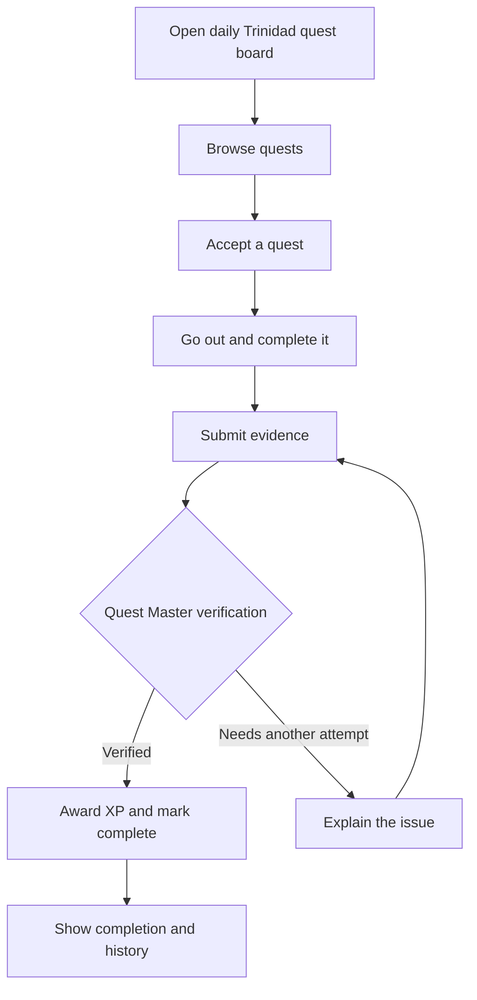

# SideQuest T&T — Product Specification

**Status:** MVP proposal  
**Product:** SideQuest T&T  
**Tagline:** Your real life is the game. Trinidad is the map.

## Vision

SideQuest T&T is a real-world RPG. A player chooses a quest, leaves the screen behind while doing it, submits evidence afterward, and earns progression when the Quest Master verifies completion. The game should make ordinary surroundings feel worth exploring and encourage players to spend more of the experience outside the app.

This is a game whose quests happen in the real world, not a travel planner.

## Target user and problem

The first intended users are people in Trinidad and Tobago who want a playful reason to explore their surroundings, try something new, or make a familiar day more engaging. The product addresses the friction of deciding what to do and the pull of spending leisure time on a screen. Quests should be practical, safe, and achievable without requiring a paid attraction or specialized equipment.

The MVP is designed to test whether this loop is enjoyable and repeatable. It is not yet a broad tourism or social platform.

## Core game loop

The key product moment is: **quest generated → accepted → player goes outside → completes it → submits proof → Gemma verifies → XP is awarded**.

## MVP scope

The MVP should provide one complete, testable player loop across **Trinidad**. Trinidad is the initial region, not a small pilot district. If time allows, add manual selection of Tobago as a stretch goal; do not let that delay the Trinidad loop.

- See a shared daily board of **5–10 quests** for Trinidad. An always-on home server runs Gemma in a container and generates the daily pool from a small, curated set of human-reviewed templates and bounded local context. The API validates and stores each candidate in MongoDB Atlas before showing it.
- Players choose from the generated pool. They cannot reroll or trigger regeneration after that day's pool is published. If today's generation fails, show the most recently published pool (normally yesterday's) with its actual date and a clear previous-pool notice. Keep its quests available for acceptance until a new pool is successfully published. If no pool has ever been published, show a clear unavailable state. If a player completed a quest yesterday, show that completion on its card while still allowing another attempt.
- Use four planned rarity tiers: Common (10–30 minutes), Uncommon (30–60 minutes), Rare (1–2 hours), and Legendary (2+ hours). Legendary is deferred from the MVP; start with Common, Uncommon, and Rare. Ideas include noticing something on a different route (Common), exploring a different neighbourhood (Uncommon), and a multi-step exploration quest (Rare). Photo-dependent quests are excluded while evidence is text-only.
- View a quest's instructions, expected duration, difficulty, reward, and safety notes.
- Quest difficulty is set by the reviewed template; player-selected difficulty is deferred.
- Accept one quest and see its active state. Only one quest may be active per player at a time; after completion or expiry, another can be accepted.
- Show a minimal active-quest screen with the task, safety guidance, and a clear return-to-submit action so the player can put the phone away.
- Complete the activity away from the screen. “Offline” means intentionally putting the phone away, not offline app support or background synchronization.
- Submit a short written account as the **single MVP evidence type**, limited
  to 2,000 characters after trimming leading and trailing whitespace. Defer
  photos until the core loop has been validated.
- Have Gemma assess the evidence against the quest's stated completion criteria.
- Require a connection to accept a quest and submit evidence. If the service is unreachable, tell the player; they may complete the activity away from the screen and submit once they are online again. If Gemma is unavailable or returns invalid output, retain the submission as pending/retryable and award no XP.
- Award XP only after verified completion; show the result in quest history and a simple player progression view. Award XP at most once per player per quest instance, even if the player accepts that same instance again.
- Persist quests and relevant player progress in MongoDB Atlas through the API.
- Use text for quest introductions and completion feedback. Defer ElevenLabs voice until after the loop is validated.

Do not add a map, live GPS, social features, or mobile-specific geolocation to this MVP. Use guest accounts for the MVP, with no email or password. Guest progress is tied to the browser and cannot be recovered across browsers/devices. XP amounts are fixed by rarity; levels are deferred. Exact values are recorded below.

## Explicit non-goals for the MVP

- A travel itinerary, booking service, or directory of businesses.
- A live map, turn-by-turn navigation, GPS, or continuous location tracking.
- Public social feeds, chat, teams, leaderboards, or user-generated quest publishing.
- Payments, subscriptions, sponsorships, or rewards with real-world monetary value.
- Fully automated proof that a player physically visited a place. Evidence review is an AI-assisted judgment, not a guarantee of truth.
- Voice generation, image evidence, or a multi-model agent framework.
- A production-scale content catalog covering every community before the core loop is tested.

## Quest lifecycle

1. **Generate:** Gemma runs on the always-on home server and creates one shared daily pool of 5–10 quest instances for Trinidad from a small, human-reviewed template set and bounded local context. The API validates each candidate before publishing the pool to Atlas. Templates provide activity shape, safety limits, and completion criteria; Gemma supplies tailored wording and bounded variation. Players cannot trigger a reroll after publication.
2. **Available:** A valid quest is stored and can appear on the player's board.
3. **Accepted:** The player starts the quest. The acceptance time and quest version should be retained so its completion rules do not silently change mid-activity.
4. **Evidence submitted:** The player submits the requested written response. The submission becomes a numbered completion attempt associated with that accepted quest.
5. **Assessment:** Gemma returns a structured assessment against the quest's explicit criteria.
6. **Verified or retry requested:** A passing assessment completes the quest. A failed assessment gives a plain-language reason and allows another attempt. The product should avoid accusing the player of dishonesty. A model outage, timeout, or invalid response leaves the attempt retryable and grants no XP.
7. **Completed:** The system records the result, awards XP once, and shows the completed quest in history.

State transitions and duplicate submissions must be handled by the API so a retry or repeated request cannot award XP twice. Each acceptance can have at most one completion. A player may accept a completed quest instance again, but earns XP only for the first verified completion of that instance. The XP ledger must enforce uniqueness by player and quest instance.

## Evidence and verification model

Evidence should be proportionate to the activity. For the MVP, use a short written answer or reflection, and design quests so that text can reasonably address their completion criteria. The quest must state what counts as acceptable evidence before acceptance. Photo evidence is deferred.

Gemma should evaluate only the accepted quest snapshot, its completion
criteria, and the submitted evidence, then return a structured result with
status (`verified`, `retry`, or `review`), a short reason, confidence, and
failed criteria where applicable. The backend validates the response. Only a
`verified` result meeting the 0.75 confidence threshold can award XP. Explicit
`review` and lower-confidence results become retryable outcomes: manual review
is not staffed in the MVP, so players must not be blocked waiting for it.
Malformed output and model failure remain pending/retryable and cannot award
XP. The product must not imply that AI verification proves identity, time, or
physical presence.

The configured local Ollama model is `gemma4:e2b-it-qat`. One disposable local
inference returned `review`; the API stored it without XP. A later hosted
submission also reached `review` for clearly irrelevant evidence, exposing a
dead end because no manual review process exists. The API and UI are being
changed so review and low-confidence outcomes allow another attempt; see
development log 016. This does not establish broader model reliability.

A submitted text cannot reliably prove identity, time, or physical location. Do not present AI verification as fraud-proof. Avoid collecting GPS or identity data for the MVP. Delete submitted evidence text 30 days after submission while retaining verification metadata; pending attempts expire without XP at that point. Image uploads are out of scope; if added later, define size/type limits, retention, access controls, and deletion behavior before launch.

## Progression

The first verified completion of a quest instance awards XP by rarity: Common 25 XP, Uncommon 50 XP, and Rare 100 XP. Replaying that same quest instance is allowed but does not award XP again. The MVP shows total XP and completion history; levels, streaks, badges, and leaderboards are deferred. These values can be tuned after playtesting.

## Regional scope

The MVP covers Trinidad as a whole. Manual selection of Tobago is a stretch goal. Quests should use locally meaningful, accessible context without assuming the player has a car, can pay an entry fee, or can safely travel at any hour. No quest should require entering private property or depend on an unverified claim about access or opening hours.

Do not make a quest depend on a precise address or private property unless the player has a clear, safe way to access it.

## Remaining implementation and test decisions

- Tune the initial 0.75 verification confidence threshold after playtesting.
- Configure the hosted worker secret and matching lease duration before
  enabling verification against the hosted API.
- Implement the scheduled evidence deletion job.

## Success criteria

The MVP is successful when a first-time player can complete the full loop without developer intervention and the stored state is correct:

- A player can access the current Trinidad board—or a clearly dated previous pool if generation failed—and find an appropriate quest.
- A returning player sees a completion marker on quests completed yesterday and can still accept that quest again.
- A player can accept it, complete it away from the screen, and submit evidence.
- Valid evidence produces a clear verified result; the first verified completion of each quest instance earns exactly one XP award.
- Replaying an already completed quest instance is allowed, shows its completion date, and awards no additional XP.
- Insufficient evidence produces a useful retry path and no XP award.
- The result remains visible in quest history after the session.
- The loop remains understandable without voice generation.
- Playtesting shows that quests feel safe, locally relevant, and enjoyable enough that players would try another one.

Record actual playtest outcomes rather than claiming success from a working demo alone.
